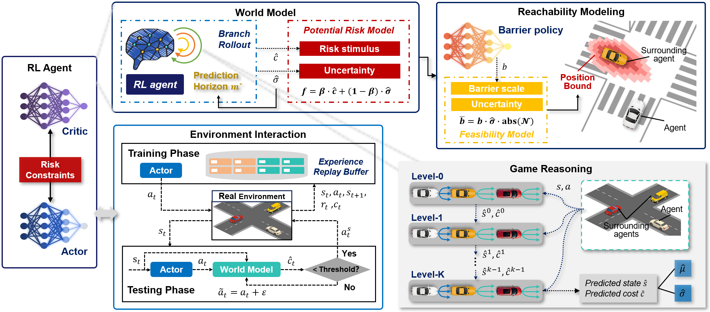

# GTR2L
This repository is the implementation of our research "**[Game-Theoretic Risk-Shaped Reinforcement Learning for Safe Autonomous Driving]**". This research has been published in [IEEE TNNLS](https://ieeexplore.ieee.org/document/11793015). 


## Introduction
Schematic of the Proposed GTR2L Framework for Safe Autonomous Driving
<p align="center">
  
</p>
A growing body of work in traffic cognition and interactive decision-making indicates that human road users recursively anticipate the strategic behaviors of neighboring vehicles and adjust safety boundaries according to perceived uncertainty, a capability that underpins safe negotiation in complex intersections and highway scenarios. Model-based reinforcement learning further highlights the value of world models for forecasting potential hazards before they materialize. Drawing on these observations, this work proposes GTR2L, a unified safe RL framework that integrates game-theoretic interaction prediction, adaptive-horizon risk modeling, and dynamic barrier constraints, to endow autonomous vehicles with proactive risk awareness for safe and efficient driving.

## Demonstration

In all demonstrations, the red-colored car represents the GTR2L-driven autonomous vehicle.

1. Unprotected left-turn task at an unsignalized intersection with oncoming traffic (TrafficEnv1-v0)

<p align="center">
  
</p>

2. Unprotected straight-crossing at an unsignalized intersection with crossing traffic (TrafficEnv2-v0)

<p align="center">
  
</p>

3. Consecutive signalized intersections with mixed traffic flows (TrafficEnv3-v0)

<p align="center">
  
</p>

4. Long-distance composite scenario with mixed traffic flows (TrafficEnv4-v0)

<p align="center">
  
</p>

## User Guidance
### Installation
This repo is developed using Python 3.7 and PyTorch 1.3.1+CPU in Ubuntu 16.04. 

We utilize the proposed FNI-RL approach to train the autonomous driving agent in the popular [Simulation of Urban Mobility](https://eclipse.dev/sumo/) (SUMO, Version 1.2.0) platform.

We believe that our code can also run on other operating systems with different versions of Python, PyTorch and SUMO, but we have not verified it.

The required packages can be installed using

	pip install -r requirements.txt

### Run
 There are four traffic environments, including TrafficEnv1-v0, TrafficEnv2-v0, TrafficEnv3-v0, and TrafficEnv4-v0. 
 For example, users can leverage the following command to run the code in the terminal and train the autonomous driving agent under the unprotected left turn task at an unsignalized intersection with oncoming traffic:

	python run_env_1_2.py --env_name TrafficEnv1-v0
 Users can also use the following command to run the code in the terminal and train the the autonomous driving agent under the signalized intersection and long-term goal-driven navigation task with mixed traffic flows:

	python run_env_3.py --env_name TrafficEnv3-v0
	python run_env_4.py --env_name TrafficEnv4-v0

## Citation
If you find this repository helpful for your research, we would greatly appreciate it if you could star our repository and cite our work.
```
@ARTICLE{11793015,
  author={Hu, Dong and Hu, Fengqing and Yang, Lidong and Huang, Chao},
  journal={IEEE Transactions on Neural Networks and Learning Systems}, 
  title={Game-Theoretic Risk-Shaped Reinforcement Learning for Safe Autonomous Driving}, 
  year={2026},
  volume={},
  number={},
  pages={1-14},
  doi={10.1109/TNNLS.2026.3748216}}
```
```
@article{hu2026self,
  title={Self-aware active learning enables continual improvement in autonomous driving},
  author={Hu, Dong and Huang, Chao and Lee, Carman KM and Kanoulas, Dimitrios},
  journal={arXiv preprint arXiv:2608.29772},
  year={2026}
}
```
