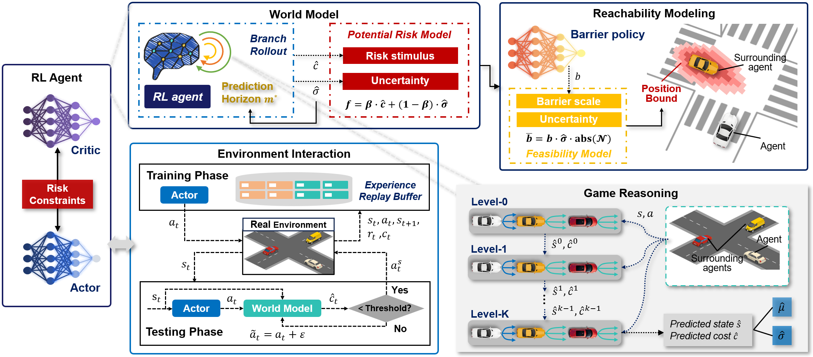
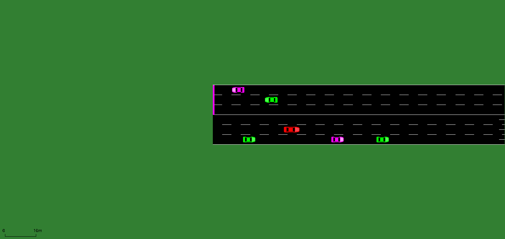
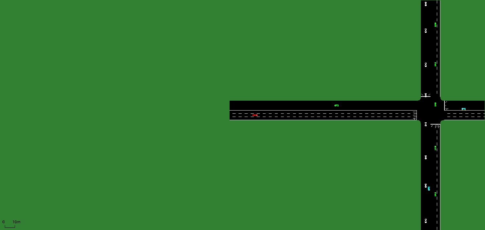

# GTR2L
This repository is the implementation of our research "Game-Theoretic Risk-Shaped Reinforcement Learning for Safe Autonomous Driving". This research has been accepted by IEEE TNNLS.

We are organizing the code and will release it in early November.

## Introduction
Schematic of the Proposed GTR2L Framework for Safe Autonomous Driving

  

A growing body of work in traffic cognition and interactive decision-making indicates that human road users recursively anticipate the strategic behaviors of neighboring vehicles and adjust safety boundaries according to perceived uncertainty, a capability that underpins safe negotiation in complex intersections and highway scenarios. Model-based reinforcement learning further highlights the value of world models for forecasting potential hazards before they materialize. Drawing on these observations, this work proposes GTR2L, a unified safe RL framework that integrates game-theoretic interaction prediction, adaptive-horizon risk modeling, and dynamic barrier constraints, to endow autonomous vehicles with proactive risk awareness for safe and efficient driving.

## Demonstration

In all demonstrations, the red-colored car represents the GTR2L-driven autonomous vehicle.

1. Unprotected left-turn task at an unsignalized intersection with oncoming traffic (TrafficEnv1-v0)

  

2. Unprotected straight-crossing at an unsignalized intersection with crossing traffic (TrafficEnv2-v0)

  

3. Consecutive signalized intersections with mixed traffic flows (TrafficEnv3-v0)

  

4. Long-distance composite scenario with mixed traffic flows (TrafficEnv4-v0)

  

